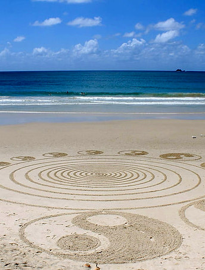

::: {.columns}
::: {.column width="20%"}
{fig-alt="Mandalas in the sand" width="90%" style="border-radius: 8px;"}
:::

::: {.column width="80%"}
**Read. Read. Read.** Read the scientific literature. You absolutely cannot cannot cannot write well without knowing what others have done. Doing science is having a conversation with the science that has gone before it. So if you’ve read only sparsely, it’s like evesdropping onto a conversation in a loud restaurant. You really can’t join that conversation smoothly. Read a few classics, but focus on stuff written in the last five years. Otherwise, its like bringing up a topic in a conversation the group has moved on from.

**Write your title then your abstract first.** Many people do this last, and you will need to come back at the end and revise them. But if you can’t entitle your paper and can’t write a compelling abstract, you’re going to really struggle with the paper. If you have co-authors, send them the title and abstract for feedback before proceeding. Your title is your main message, the thing that you want your reader to remember a month after they read your paper. The abstract is a summary of what you found and why it’s interesting. Many people will only read the abstract, so they need to “get” it from the abstract. “Implications are discussed,” is a horrible thing to see in an abstract. Having asked for co-authors’ feedback, hone that main message with their support until you have it, then proceed. This will save a *lot* of time.

**Make your figures *before* you start writing.** They don’t have to be picture perfect at this stage, but a lot of science is communicated through figures, and it’s a lot easier to write “around” them. They basically demonstrate your key point. Identify the *one* key figure and write especially around that. Send your figures around to co-authors for feedback. Take their feedback seriously.

**Outline** your paper before writing. Outline each paragraph and within each paragraph. While doing that, note citations. Nothing interrupts good writing flow than breaking to find the “perfect” citation. Outlining could take several hours.

**The three-paragraph Introduction.** A professor once told me the ideal Introduction has three paragraphs: the big picture, the specific part of it you’re tackling, then the “Here we …” paragraph. I don’t think I have ever achieved an only-three introduction to a paper, but it’s a good way to conceptualize the goal.

**Focus on topic sentences.** Another professor of mine told me that if you were to read only the first sentence in each paragraph, you should be able to basically "get" the paper. So write like that.

**Write in a circle.** A good Discussion circles back to the issues raised in the Introduction. I don’t have a set structure for a Discussion, but it usually flows something like this, with only the first paragraph being "obligatory":

We found that… (main finding). Then a summary of everything else below, ending with the *main* message of your paper. (An editor in chief I admire once said that to assess whether to reject a submission or send it to an associate editor, he reads the abstract, then the first paragraph of the discussion.)

Unpack main message 1

Unpack main message 2

Nuances

Caveats / future work. This is nearly obligatory in any article, but you can often cast limitations as areas for future research because—after all—they are.

Conclusion (basically, a mini-abstract reiterating the main findings, but broaden it to inspire future work).

**Write for a specific journal.** Each journal has subjects they prefer and ones they don’t. Look that up and know why your intended article belongs there and not somewhere else. For example, in my field, Diversity and Distributions wants articles that have a geographic component and a biological conservation component. So if my article would not have both of those facets, I’d send it elsewhere.

Find three or so articles in your target journal that you think are written well and are similar to yours and outline them. You can use these as a template for your article’s outline.

**Get feedback** from co-authors twice (or more). Once after you've written a "rough" draft and once after you have a "near-final" draft. When you send off the rough version, tell them you only want feedback on the gross structure, logic, and interpretation, not fine details like wording. People (like me) can't help themselves and will correct your grammar anyway, but you don't want a "near-final" draft with gaping holes. Telling people what kind of feedback you want is a great way to get it.

**Keep at it.** I’ve not yet written an article that I didn’t become sick of by the end. I hope you have better experiences. But it really takes that much rewriting. Sorry. But it will pass.

**Be a nun/monk.** There are Buddhist monks who spend their days tracing intricate designs on the beach so they can be washed away by the rising tide. Submit your paper like a monk. Have a plan B for outright rejection (meaning, which journal will you send it to next? Not, “I’m gonna burn my bridges with that ignoramus editor…”). But, more likely, be prepared for major revisions. Nearly every article will require them.

**Celebrate.** What!? I thought I said you’d get sick if it and the tide will erase your art and the editor doesn’t know their head from a pulsating sea squirt! Yeah, but that’s the point. The editor is never going to write back and say, “Wow, your first submission really blew me away!” And your co-authors often reply with one-liner emails like “Woohoo!” which is nice but unworthy of the boulder you rolled up the hill. It’s up to *you* to celebrate and *when* to celebrate. Outline done? Woohoo! (Then go do something celebratory.) Rough draft to co-authors? Woohoo! First submission? (Woohoo!) Third submission? Woohoo! The average person just doesn’t realize how difficult being an academic is, but you do, and you need to make it good for yourself. Papers shouldn’t be a relief and a curse. They’re an expansion of human knowledge, and they should be celebrated as such by the person who wrote them.

\~ Adam
:::
:::
