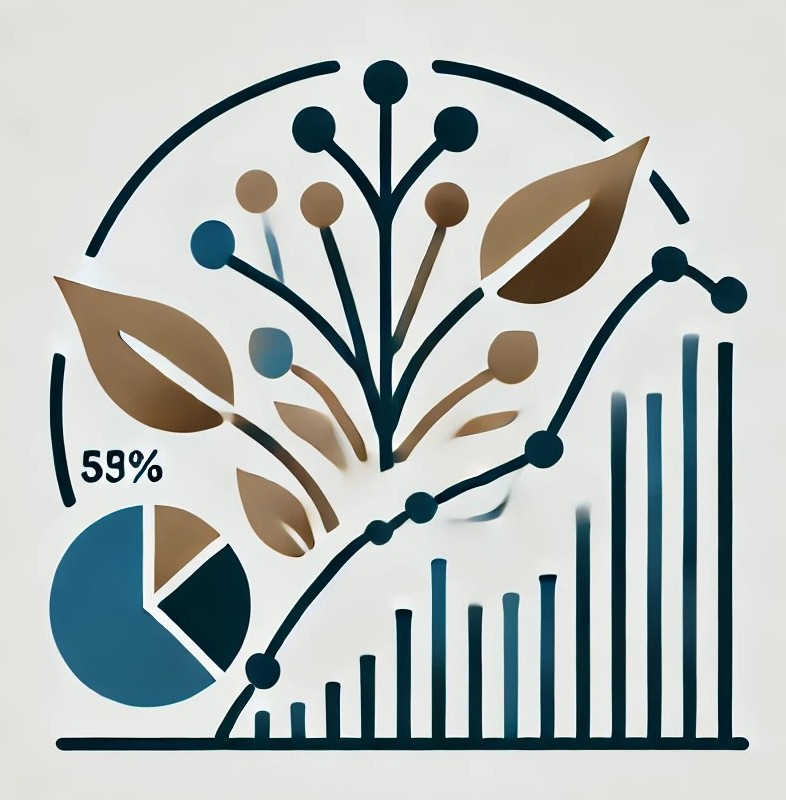

:::: {.news-item-layout}
::: {.news-item-text}

Two of our lab’s papers have been commended for being in their respective journals’ “top 10 most cited for 2023”! Both papers were inspired by our real-world experience in species distribution modeling where people typically discard spatially inaccurate but erstwhile usable specimens, or entire species because they have just a few occurrences. Trying to push the envelope to include them in the “usable” category, we’ve pioneered and evaluated methods to do so.

**Modeling the rarest of the rare: A comparison between multi-species distribution models, ensembles of small models, and single-species models at extremely low sample sizes** \[[open access](https://dx.doi.org/10.1111/ecog.06500)]
**Erickson**, K.D. and **Smith**, A.B.  2023. *Ecography* 2023:e06500.

**Including imprecisely georeferenced specimens improves accuracy of species distribution models and estimates of niche breadth** \[[article](https://dx.doi.org/10.1111/geb.13628) | [open access pre-print](https://doi.org/10.1101/2021.06.10.447988)\]
**Smith**, A.B., **Murphy**, S.J., **Henderson**, D., and **Erickson**, K.D. 2023. *Global Ecology and Biogeography* 32:342-255.
:::

::: {.news-item-image}

{.img-fluid .rounded}
:::
::::
