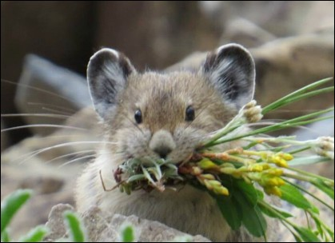

:::: {.news-item-layout}
::: {.news-item-text}

The iconic American pika ranges along the crest of the Sierra Nevada stretching from north to south–or so we thought. Published in Ecosphere, our recent work uses field surveys and species distribution modeling to identify a previously unknown gap in the range of the pika near the “elbow” of eastern California. This gap is caused by inhospitable climatic conditions, which are becoming even more inhospitable due to climate change, leading to an even greater disjunction. Interestingly, sites with no historical evidence of pikas were solidly within inhospitable areas, whereas sites with signs of recent occupancy, but not current occupancy, were intermingled with sites that were occupied, suggesting either metapopulation dynamics or an extinction “debt” yet to be paid.

**Expanding barriers: Impassable gaps interior to distribution of an isolated mountain-dwelling species** \[[open access](https://doi.org/10.1002/ecs2.70223)\]
Beever, E.A., **Smith**, A.B., Wright, D. Rickman, T., Gerraty, F.A., Stewart, J.A.E., Gill, A., Klinger, K., and Robinson, M.  *Ecosphere* 16:e70223.
:::

::: {.news-item-image}

[{.img-fluid .rounded}](https://doi.org/10.1002/ecs2.70223)
:::
::::
