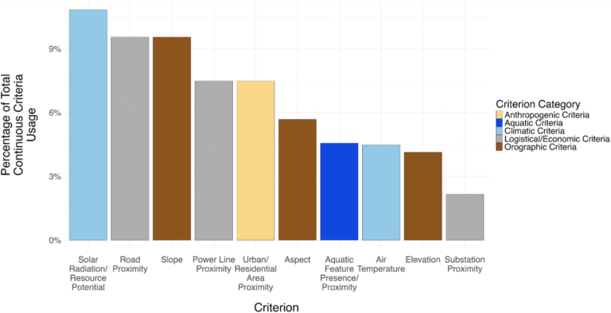

:::: {.news-item-layout}
::: {.news-item-text}

Our recent work finds that when decisions are made about where to locate new solar energy installations, biodiversity and conservation are accounted for only in a very simplistic, strictly “regulatory” manner–not in the complex, nuanced manner that these issues actually deserve.

**Bibliographic synthesis of biodiversity-relevant criteria for solar energy sitings** \[[open access](https://doi.org/10.1016/j.rser.2025.116026)\]
Levin, M., Condon, D., Krasner, N.Z., Forester, E., Holmes, C.C., Bateman, B.L., Delach, A., Ennen, J.R., Kalies, E.L., Kays, R., Lovich, J.E., **Smith**, A.B., Wu, G.C., and Hernandez, R.R. *Renewable & Sustainable Energy Reviews* 223:116026.
:::

::: {.news-item-image}

[{.img-fluid .rounded}](https://doi.org/10.1016/j.rser.2025.116026)
:::
::::
