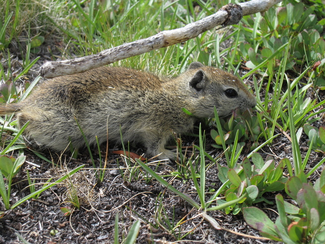

:::: {.news-item-layout}
::: {.news-item-text}

In a recent analysis, Lab alum Ethan Abercrombie used historical surveys by Joseph Grinnell of small mammals of the Sierra Nevada and modern resurveys to ask how well they were tracking climate change. The answer? Not as fast as needed.

Ethan calculated, for each site surveyed along elevational transects, the average temperature and precipitation preference of each community of mammals. This entailed estimating, for each species, its preferred temperature or precipitation, then averaging across all species at each site. He then combined these estimated to generate a “community temperature index” or “community precipitation index” of each site’s community. Communities can shift their indices by gaining or losing species. So, Ethan calculated these indices for 100 yr ago when Grinnell surveyed the sites, and for the present when resurveys were conducted.

The result? Communities were shifting by about 0.0063°C per year and by 0.04 mm per year. These values are small, but over a century, they add up as species enter and leave communities. In contrast, temperature has warmed by 0.01° per year and precipitation diminished about 2.5 mm per year–that is, much faster (and in the opposite direction for precipitation!) than the communities were changing.

The result is a a dramatic lag between communities and climate. As climate change accelerates, we can expect even more shifts in these communities. Add in other stressors from change in fire regimes, air pollution, and shifts in vegetation, and we can only promise a dramatic change in the biodiversity of the Sierra Nevada.

**Lagged responses in the composition of small mammal communities to a century of climate change** [[article](https://doi.org/10.1002/ecog.08010)] 
**Abercrombie**, E., Myers, J., Usdin\*, R.R., and **Smith**, A.B. 2026. *Ecography* 2026:e08010. 
\* Undergraduate student
:::

::: {.news-item-image}

[{.img-fluid .rounded}](https://doi.org/10.1002/ecog.08010)
:::
::::
