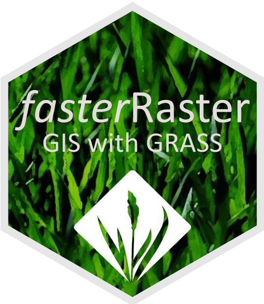

:::: {.news-item-layout}
::: {.news-item-text}

Within R, the *terra* and *sf* packages are the go-to solutions for geospatial analysis, but can struggle with rasters with many cells and vectors with many features. The standalone, open-source GRASS software allows efficient processing of large rasters and vectors. However, connecting to GRASS through R can be cumbersome and requires users to become familiar with GRASS-specific syntax, file organization, and data templates.

I’m happy to announce the official publication of an article in *Transactions in GIS* detailing *fasterRaster*, the first user-friendly R package that allows users of R to harness the power of GRASS. terra and sf will nearly always be faster for processing of small- and medium-sized spatial objects, but for large objects, fasterRaster can be several times faster and enable processing where other solutions fail.

* Package [CRAN](https://cran.r-project.org/package=fasterRaster) page
* [Tutorial and documentation](https://adamlilith.github.io/fasterRaster/index.html)
* [Repository](https://github.com/adamlilith/fasterRaster)

***fasterRaster*: GIS in R using GRASS for large vectors and rasters ** [[preprint](https://doi.org/10.1111/tgis.70238) | [article](https://doi.org/10.1111/tgis.70238)] 
**Smith**, A.B. 2026. *Transactions in GIS* 30:70238.
:::

::: {.news-item-image}

[{.img-fluid .rounded}](https://doi.org/10.1111/tgis.70238)
:::
::::
