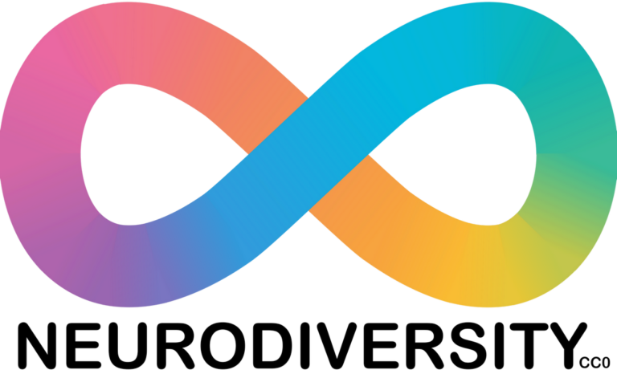

:::: {.news-item-layout}
::: {.news-item-text}

Neurodiversity encompasses the natural phenotypic variation found in human brain function and perception. Many neurodivergent identities impart strengths that are valued in science, and yet barriers often dissuade them from succeeding. In a recent “10 Simple Rules” paper, we–a team of neurodivergent authors and allies–establish a set of guidelines for making science friendly to neurodiversity. In summary form:

* Reorient toward a social model of neurodiversity
* Recognize that neurodiversity is diverse!
* Recognize that neurodiversity is often hidden.
* Address common barriers and provide accommodations to everyone.
* Build on pre-existing strengths.
* Define progress on individual terms.
* Embrace your own neurodivergent identity.
* Create a culture supportive of neurodiversity.
* Seek outside assistance.
* Change the institution, then the world.
  
  *Let’s don’t force a square peg in a round hole; let’s create more square holes.*
  – Gary Moore, nonPareil Institute co-founder

**Ten simple rules for mentoring and being mentored while neurodiverse** [[article](https://doi.org/10.1371/journal.pcbi.1013917)] 
**Smith**, A.B., Adams, E.G., Abercrombie, E., Bibi, N., Bottini, C.L.J., Brown, A.J., Cavalieri, C.N., Clauser, A.L., Duguid, M.C., Fowler-Finn, K., Hutchen, J., Jardim, V.L., Rodriguez, C.S., Swab, R.M. and Varghese, S. 2026. *Public Library of Science Computational Biology* 22:e1013917.
:::

::: {.news-item-image}

[{.img-fluid .rounded}](https://doi.org/10.1371/journal.pcbi.1013917)
:::
::::
