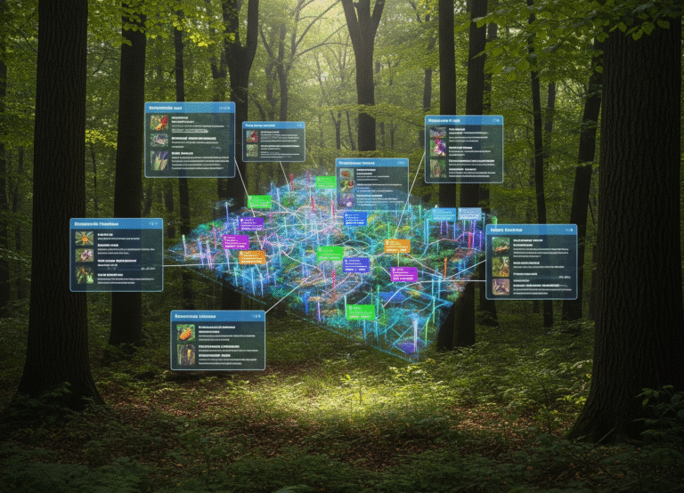

:::: {.news-item-layout}
::: {.news-item-text}

The biodiversity data landscape is confusing! Hundreds of disparate databases, with non-standardized formats and often little description of fields and contents, and search engines that return either few results or hundreds. Perforce, our [Opportunistic Database of Biodiversity Databases](https://docs.google.com/spreadsheets/d/1qsK1MNLsi-QjK9VptgeV2HfrB7mWUVxjZdaj_P9Qs-Y/edit?usp=sharing) contains metadata on 100s of databases–and our experience has been that it’s often impossible to really know what is actually in a databases without actually downloading it.

Our vision is of a unified, community- and AI-curated and organized biodiversity data infrastructure which would provide a searchable index, clear metadata standards, and tools for integrating and comparing databases–described in our new article in BioScience!

**The next stage of biodiversity informatics: Community-driven synthesis and integration of biodiversity databases** \[[open access](https://doi.org/10.1093/biosci/biaf112)\]
Feng, X., **Smith**, A.B., Boyle, B., Chen, X., Enquist, B.J., Gallagher, R., Hammock, J., Ho, J.C., Lien, A.M., Maitner, B., Sokol, E.R., Soltis, P., Wenk, E.H., Willoughby, A., and Park, D.S. 2025. *BioScience* 75:913-925.
:::

::: {.news-item-image}

[{.img-fluid .rounded}](https://doi.org/10.1093/biosci/biaf112)
:::
::::
