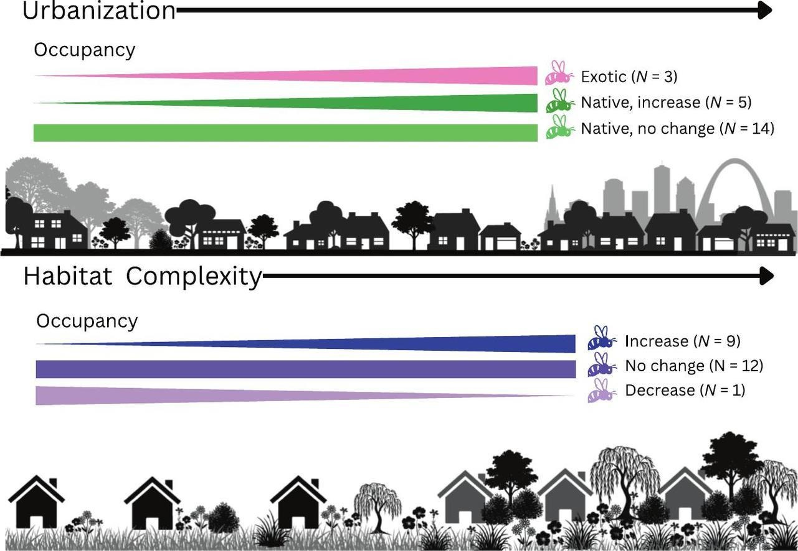

:::: {.news-item-layout}
::: {.news-item-text}

In a recent publication, along with other colleagues, former lab REU student Evelyn Guerrero and Adam found that across an urban-suburban-rural gradient that native bees preferred yards with complex vegetation, and that this effect outweighed the effect of urban-ness! In other words, by managing yards so that they have many layers, plant species, and density, people can favor native bee species, even if they are in the “heart” of the city. The nutshell of the paper is described in an interview with [KMOX](https://www.audacy.com/stations/kmox/shows/total-information-am-d5425/episodes/4d4085a8e434) (starts at 8:09 AM) and in a story by Saint Louis Public Radio.

**Effects of habitat complexity on urban bee occupancy eclipse those of urbanization and flower diversity** [[article](https://doi.org/10.1016/j.biocon.2026.111936)] 
Pho\*, J., Davis\*, C., Kapp\*, C., **Guerrero**\*, E., Fogal, N.S., **Smith**, A.B., and Miller-Struttmann, N.E. 2026. *Biological Conservation* 321:111936.

\* Undergraduate authors
:::

::: {.news-item-image}

[{.img-fluid .rounded}](https://doi.org/10.1016/j.biocon.2026.111936)
:::
::::
