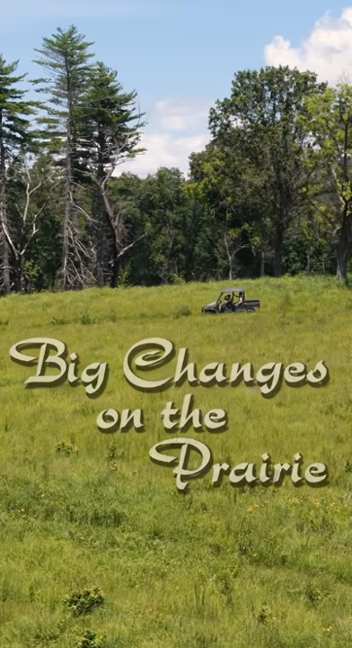

:::: {.news-item-layout}
::: {.news-item-text}

Patterns of invasion are almost always studied across small areas and for short time periods. In an exciting new article, we show that non-native plants of Missouri’s tallgrass prairies have increased in relative abundance in almost all parts of the state over the past 130 years. The article is also featured in the forthcoming Royal Botanic Garden, Kew’s *State of the World’s Plants and Fungi 2027*. Read the short [summary](https://discoverandshare.org/2026/07/08/missouri-botanical-garden-scientists-use-herbarium-specimens-to-support-prairie-conservation/) and watch the [trailer](https://youtube.com/shorts/w40Py7e8x1I?si=irKPuCId8T7mF8Gk)!

**Herbarium specimens reveal regional patterns of tallgrass prairie invasion and changing species abundance across 130 years** [[preprint](https://doi.org/10.32942/X20S76) | [article](http://doi.org/10.1111/nph.70632)] 
Austin, M.W., Kaul, A.D., **Smith**, A.B., Rothendler, M., and Primack, R.B. 2026. *New Phytologist* 251:881-895.
:::

::: {.news-item-image}

[{.img-fluid .rounded}](https://youtube.com/shorts/w40Py7e8x1I?si=irKPuCId8T7mF8Gk)
:::
::::
