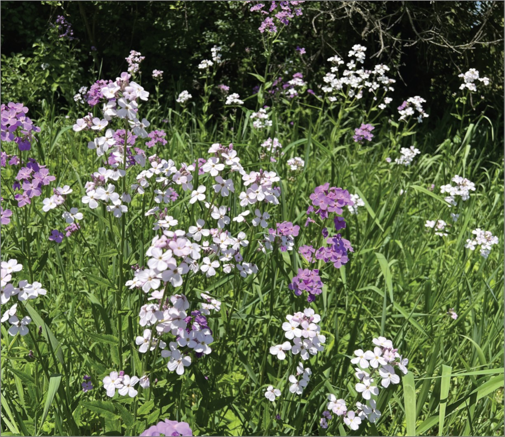

:::: {.news-item-layout}
::: {.news-item-text}

Congratulations to Mia, who published the results of an undergraduate research project on how herbivory can destabilize plant polymorphism. Typically, it is expected that negative frequency dependence will maintain polymorphism in plant populations, but this study shows that herbivory can disrupt this stabilizing process.

**Herbivory weakens the stability of a floral polymorphism** [[article](https://doi.org/10.1086/742256)] 
Gaughan, M.K., Pan, V.S., Martin-Eberhardt, S., Wetzel, W.C., and Gilbert, K.J. 2026. *American Naturalist* 208:385-395.
:::

::: {.news-item-image}

[{.img-fluid .rounded}](https://doi.org/10.1086/742256)
:::
::::
