## Current Members

::: {.person-profile}
::: {.person-profile-image}
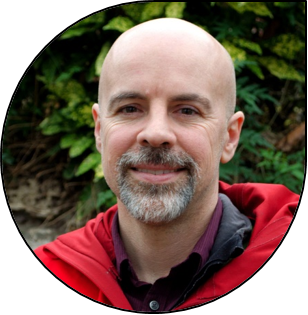{.img-fluid .rounded}
:::
::: {.person-profile-details}
**Adam B. Smith, Ph.D.**

Grand Poobah

[*Curriculum vitae*](/assets/adam_b_smith.pdf) ·
[Google Scholar](https://scholar.google.com/citations?user=_vVCUiIAAAAJ&hl=en) ·
[ResearchGate](https://www.researchgate.net/profile/Adam-Smith-119) ·
[GitHub](https://github.com/adamlilith) ·
[How to Write a Scientific Paper](./blog/how_to_write_a_scientific_paper.html)
:::
:::

::: {.person-profile}
::: {.person-profile-image}
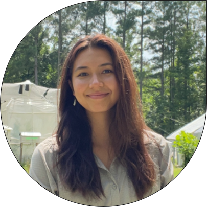{.img-fluid .rounded}
:::
::: {.person-profile-details}
**Mia Gaughan**

Ph.D. student at Washington University in Saint Louis

Mia combines a study of animals and plants to understand the biogeographic patterns and implications of herbivory and herbivore defense.

:::
:::

::: {.person-profile}
::: {.person-profile-image}
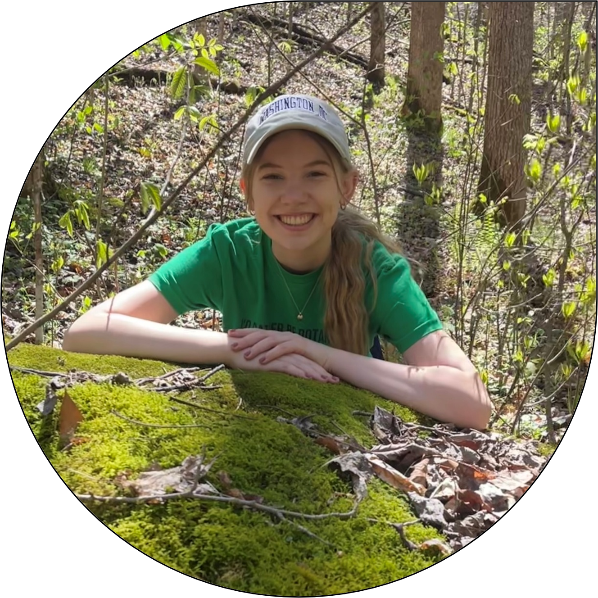{.img-fluid .rounded}
:::
::: {.person-profile-details}
**Jillian Cieslik**

Ph.D. student at Washington University in Saint Louis

Jillian's research uses phylogeograhic and biogeographic tools to evaluate alternative hypotheses for explaining speciation and population differentiation of rare plants. She is an especial fan of liverworts and other bryophytes.

:::
:::

## Lab Alumni

::: {.person-profile}
::: {.person-profile-image}
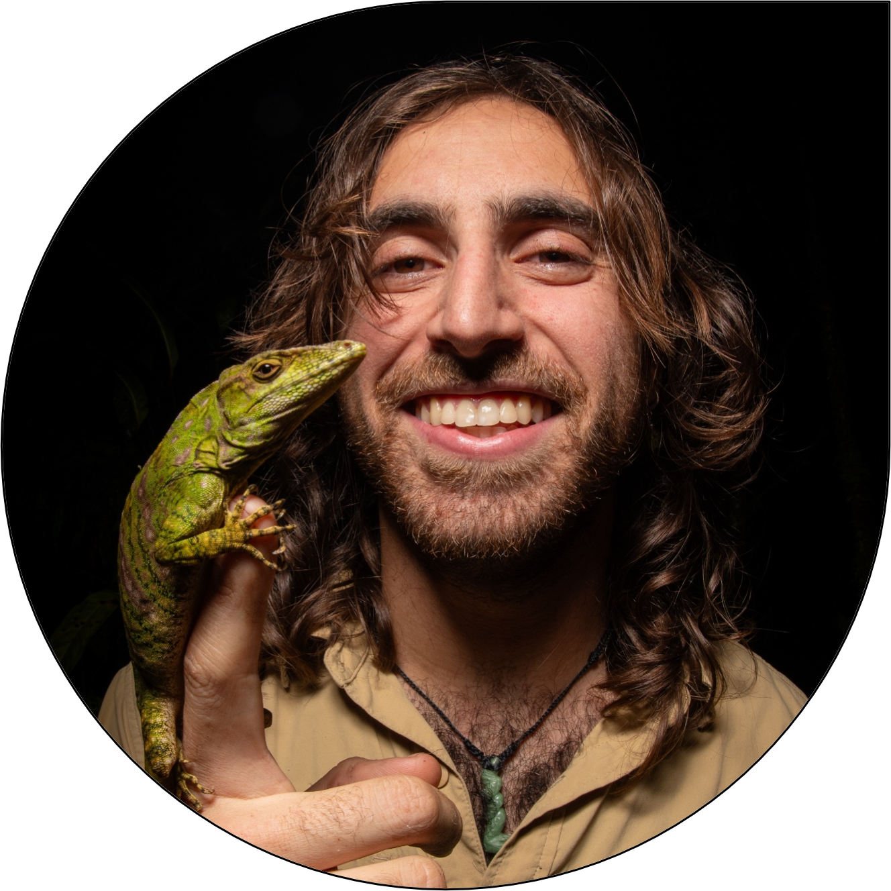{.img-fluid .rounded}
:::
::: {.person-profile-details}
**Tasman Rosenfeld**

PhD Student

Taz is an accomplished herpetologist who completed a lab rotation in the GCCL to learn species distribution modeling. He applied these tools to predict hotspots of snakebites of Honduras, which rise in incidence after clearcutting.
:::
:::

::: {.person-profile}
::: {.person-profile-image}
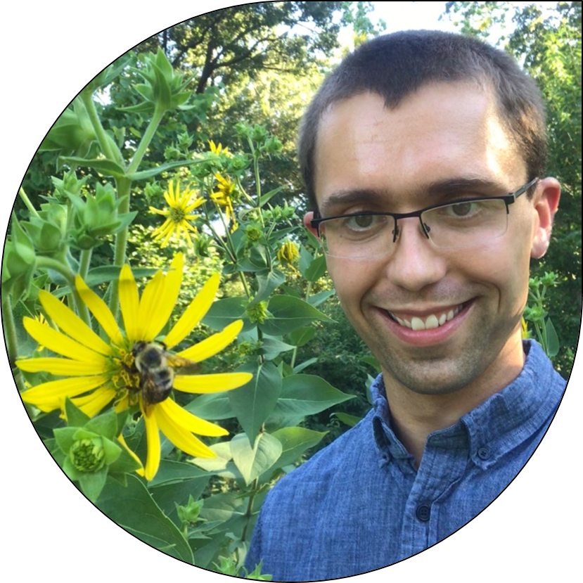{.img-fluid .rounded}
:::
::: {.person-profile-details}
**Dr. Matt Austin**

Postdoc

Matt was a postdoc sponsored by the [Living Earth Collaborative](https://livingearthcollaborative.wustl.edu/) of Washington University in Saint Louis. Matt used contemporary and historical herbarium specimens to examine how climate change has affected reproductive strategies and community re-assembly in plants. He now serves as the Missouri Botanical Garden’s [Curator of Biodiversity Data](https://matthew-w-austin.weebly.com/), and the GCCL is happy to host joint lab meetings with him and his group!
:::
:::

::: {.person-profile}
::: {.person-profile-image}
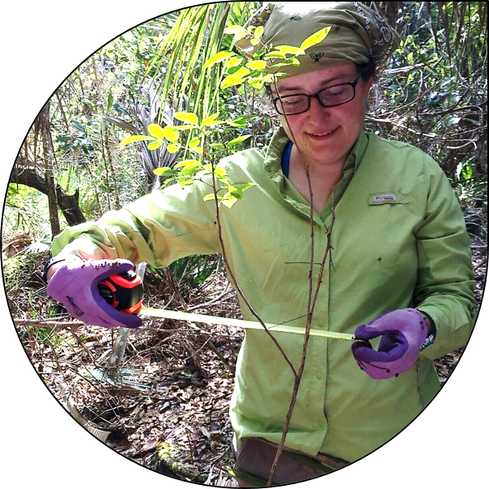{.img-fluid .rounded}
:::
::: {.person-profile-details}
**Dr. Kelly Erickson**

Postdoc

Kelly was a postdoc sponsored by the Institute for Museum and Library Services and the USG Geological Survey. She developed methods for reducing bias in models of plant distributions and evaluated how well multi-species models can capture the distribution and niches of very rare species.
:::
:::

::: {.person-profile}
::: {.person-profile-image}
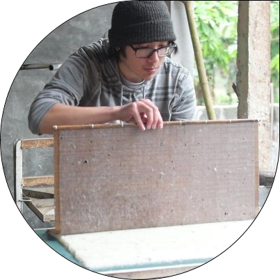{.img-fluid .rounded}
:::
::: {.person-profile-details}
**James Lucas Ojascastro**

PhD Student at Washington University in Saint Louis

James is a polymath who studied the ethnobotany of traditional papermaking in Viet Nam, Nepal, and elsewhere, and how climate change is expected to affect the handmade paper industry and the plants they depend on. He now serves as a researcher at the Atlantic Botanic Garden!
:::
:::

::: {.person-profile}
::: {.person-profile-image}
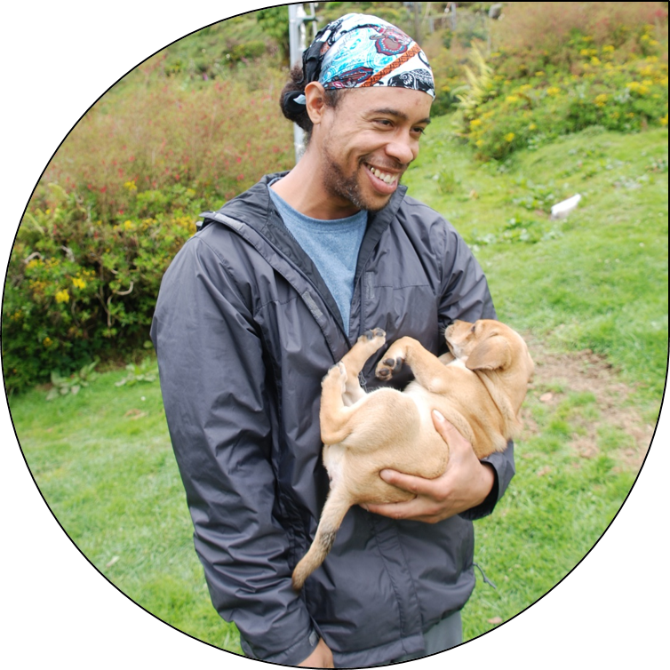{.img-fluid .rounded}
:::
::: {.person-profile-details}
**David Henderson**

PhD Student at Washington University in Saint Louis

David was studied under Dr. Jonathan Myers of Washington University in Saint Louis, where he researched spatial and chemical signatures of community assembly. He also spent a term doing a rotation in our lab looking at how we can better used imprecisely-georeferenced herbarium and museum specimens to study global change.
:::
:::

::: {.person-profile}
::: {.person-profile-image}
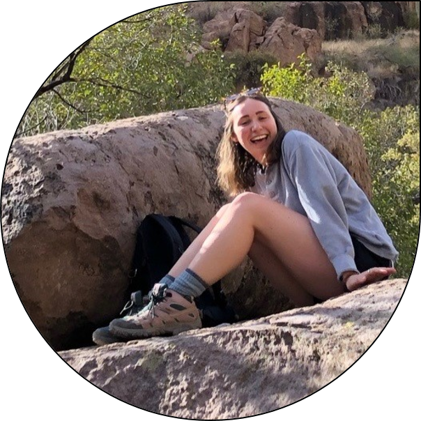{.img-fluid .rounded}
:::
::: {.person-profile-details}
**Lauren Jenkins**

Post-baccalaureate Researcher

Lauren was a post-baccalaureate sponsored by the National Science Foundation. She conducted research on how to best reconstruct the paleodistributions of trees across the last 21,000 yr using pollen and herbarium occurrences. After her term, Lauren left to study as a PhD student at Duke University.
:::
:::

::: {.person-profile}
::: {.person-profile-image}
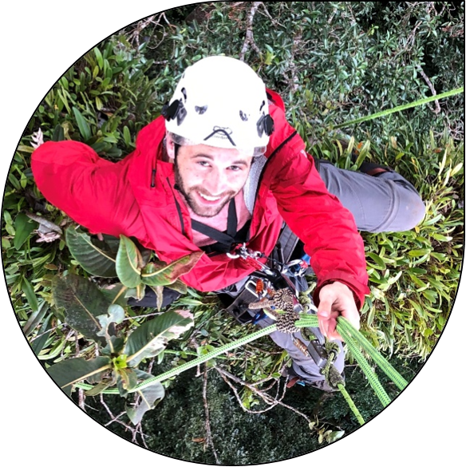{.img-fluid .rounded}
:::
::: {.person-profile-details}
**Ethan Abercrombie**

PhD Student at Washington University in Saint Louis

Ethan is a PhD student in Dr. Jonathan Myers’s lab who conducted research on biome boundaries and and how montane mammalian communities have—or have not—kept pace with climate change across the past century.
:::
:::

::: {.person-profile}
::: {.person-profile-image}
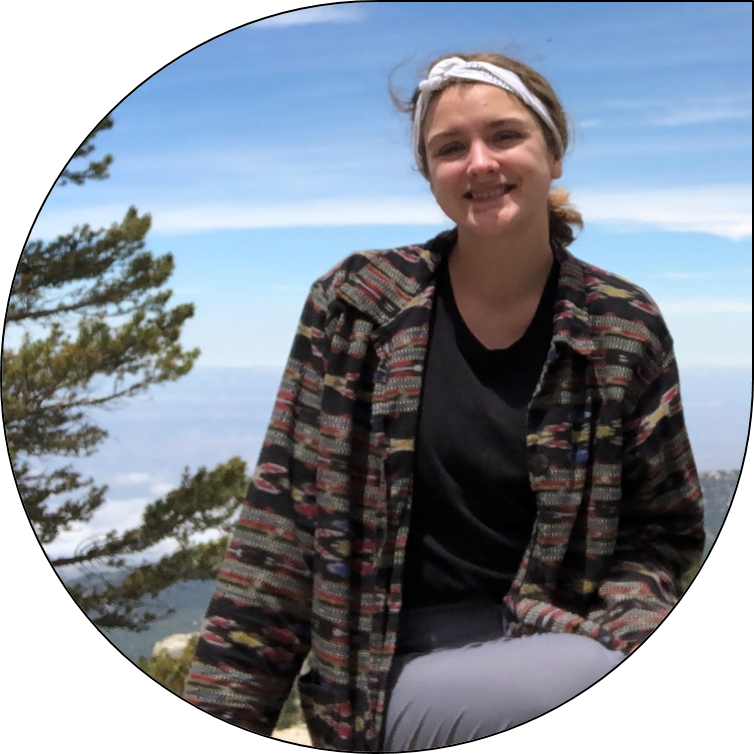{.img-fluid .rounded}
:::
::: {.person-profile-details}
**Kelsey Bartlett**

Undergraduate Researcher at George Washington University

Kelsey, who studied with Dr. Amy Zanne, used a ~120-yr data set to examine how flowering and fruiting phenology of species in the genus *Leavenworthia* has responded in response to climate change. Upon graduation, she was happy to take a position at Atlanta Botanic Garden working on conservation horticulture.
:::
:::

::: {.person-profile}
::: {.person-profile-image}
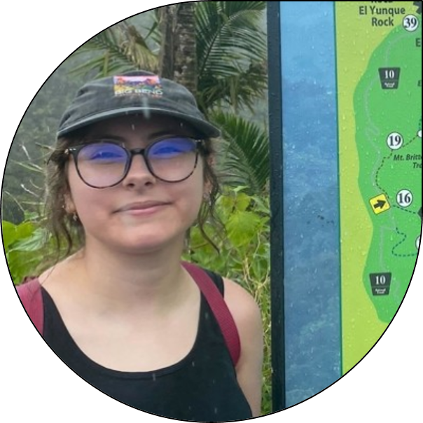{.img-fluid .rounded}
:::
::: {.person-profile-details}
**Evelyn Guerrero**

Undergraduate Researcher

Evelyn, a student at the University of Texas–Permian Basin in Dr. David Hembry’s lab, was with us for a summer in the Missouri Botanical Garden’s Research Experience for Undergraduates program. Her research project, which was co-advised by Dr. Nicole Miller-Struttmann of Webster University, examined how ground- and stem-nesting bees respond to urbanization.
:::
:::

::: {.person-profile}
::: {.person-profile-image}
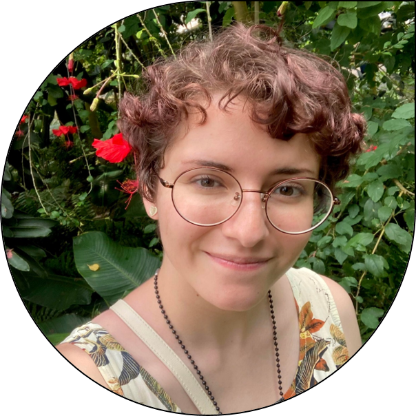{.img-fluid .rounded}
:::
::: {.person-profile-details}
**Marina Strong**

Undergraduate Researcher

Marina, a student at Lake Forest College, was a participant in the Research Experience for Undergraduates here at the Missouri Botanical Garden. She examined the prevalence of poaching and unpermitted sale of rare and endangered plants over the internet.
:::
:::

::: {.person-profile}
::: {.person-profile-image}
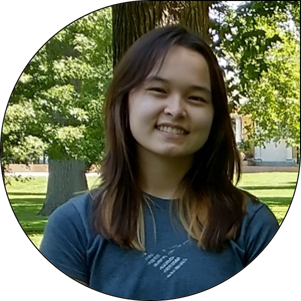{.img-fluid .rounded}
:::
::: {.person-profile-details}
**Catherine Donson**

Undergraduate Researcher

Catherine was an undergraduate student at Scripps College and worked with us under the auspices of the Garden’s Research Experience for Undergraduates program. Mentored by Dr. Matt Austin (also a lab member), Catherine launched her senior honors thesis research on how climate has affected plant phenology.
:::
:::

::: {.person-profile}
::: {.person-profile-image}
{.img-fluid .rounded}
:::
::: {.person-profile-details}
**Dr. Stephen Murphy**

Postdoc

Stephen was a postdoc whose research focused on how to apply species distribution models to address long-standing questions in community ecology. His position was sponsored by the Institute for Museum and Library Services.
:::
:::

::: {.person-profile}
::: {.person-profile-image}
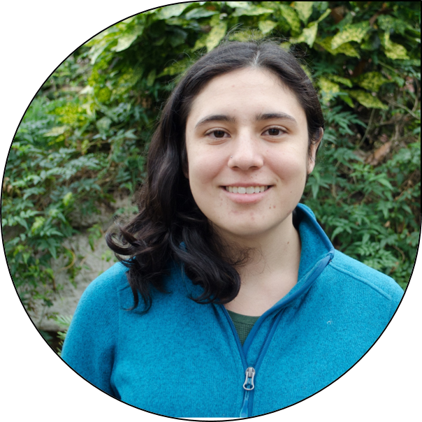{.img-fluid .rounded}
:::
::: {.person-profile-details}
**Renata Diaz**

Post-baccalaureate Researcher

Renata’s research evaluated how well we can use maps of “threats” (e.g., agricultural lands, pollution concentrations, etc.) to predict whether a particular species is actually threatened by that threat or not.
:::
:::

::: {.person-profile}
::: {.person-profile-image}
{.img-fluid .rounded}
:::
::: {.person-profile-details}
**Dr. Camilo Sanín**

Postdoc

Camilo’s research focused development of modeling methods to use the large number of imprecisely-georeferenced specimens in herbaria and museums to understand global change. Typically, these records are discarded, despite imparting valuable information. His position was sponsored by the Institute for Museum and Library Services.
:::
:::

::: {.person-profile}
::: {.person-profile-image}
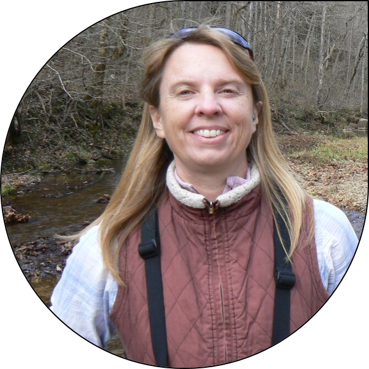{.img-fluid .rounded}
:::
::: {.person-profile-details}
**Dr. Mimi Kessler**

Visiting Researcher

Mimi is an internationally-known large-bird conservation biologist. While with us, she researched how the American pika responded to climate across its range.
:::
:::

::: {.person-profile}
::: {.person-profile-image}
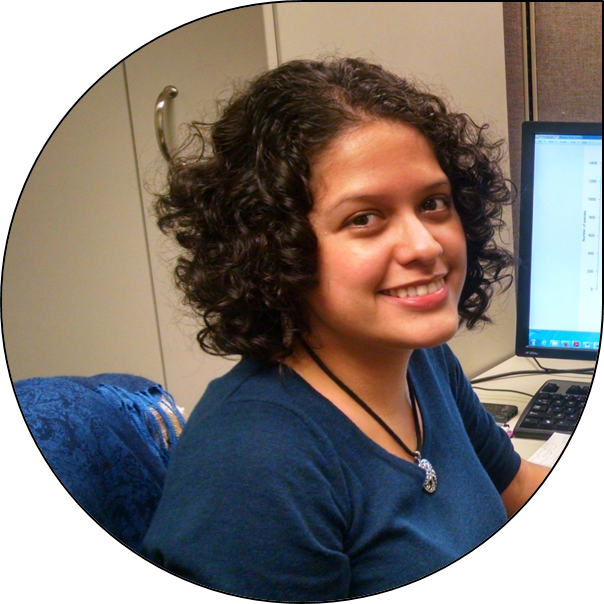{.img-fluid .rounded}
:::
::: {.person-profile-details}
**Haydée Hernández-Yáñez**

Graduate Student Research Assistant and Research Intern

Haydée earned her master’s in ecology from the University of Missouri–Saint Louis. In the Global Change & Conservation Lab, she conducted a systematic study of the threats facing all rare plants in the United States.
:::
:::
