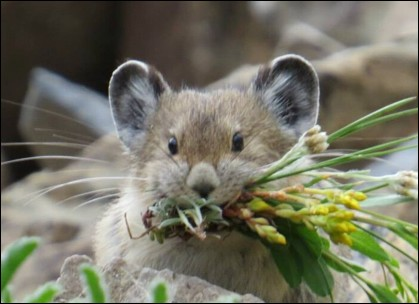
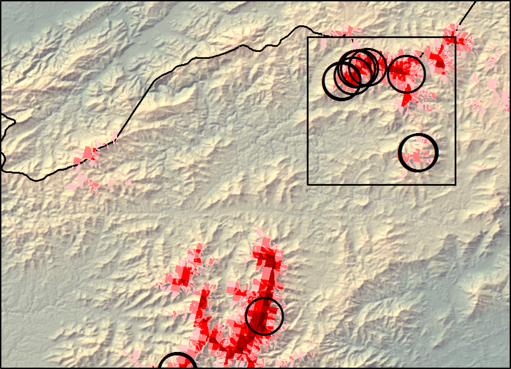
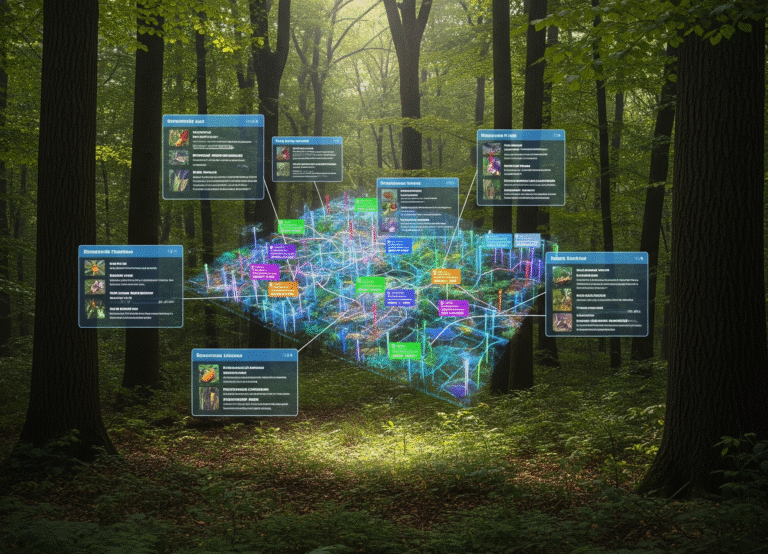

Our lab advances conservation biogeography by reconstructing species' past responses to global change so that we can build better predictive models of species' future responses. Research generally falls in to four themes: evaluating conservation status, establishing historical baselines, developing models for data-deficient species, and building the next generation of biodiversity data infrastructure.

::: {.research-section}
::: {.research-figure}

<figcaption>Columbine, *Aquilegia coerulea*, in the Rocky Mountains</figcaption>
:::

::: {.research-copy}
## PROTECT: Understanding and Forecasting Threats to Biodiversity

Across our research themes, the primary one is understanding how we can protect life on Earth. We use a wide array of methods to do this, from predictive modeling to textual analysis.

Examples: [threats to rare plants](https://doi.org/10.1016/j.biocon.2016.10.009) · [climate-smart renewable energy siting](https://doi.org/10.1038/s41558-024-01941-3) · [urban bees](https://doi.org/10.1016/j.biocon.2026.111936)
:::
:::

::: {.research-section}
::: {.research-figure}

<figcaption>American pika, *Ochotona princeps* (USGS, public domain)</figcaption>
:::

::: {.research-copy}
## TIMELINES: Reconstructing Species' Biogeographic Histories and Responses to Global Change

Understanding biotic change requires us to know what has gone before. We use a variety of data and methods to detect and measure how life has responded to global change across decadal to multi-millennial time scales. These include phylogenetic analyses and approximate Bayesian computation, examination of century-old herbarium specimens, and analysis of historical and modern resurveys.

Examples: [flowering phenology](https://doi.org/10.1111/nph.19994) · [green ash after the glaciers](https://doi.org/10.1111/jbi.14754) · [mammalian communities lag climate](https://doi.org/10.1002/ecog.08010)
:::
:::

::: {.research-section}
::: {.research-figure}

<figcaption>Locations and potential habitat of the montane endemic Cliff Avens, *Geum radiatum*</figcaption>
:::

::: {.research-copy}
## UNMODELING: Models for the Unmodelable

Most species of conservation concern are so rare that they are difficult to model, and therefore often excluded from model-based assessments! We develop and evaluate methods for including these "unmodelable" species through Bayesian methods and by leveraging data from associated species, phylogenetic relatedness, and functional traits.

Examples: [imprecise locations](https://dx.doi.org/10.1111/geb.13628) · [small "*n*"](https://dx.doi.org/10.1111/ecog.06500) · [model de-biasing](https://dx.doi.org/10.1111/ecog.05679) · [phylogenetic modeling](https://doi.org/10.1016/j.tree.2018.10.012)
:::
:::

::: {.research-section}
::: {.research-figure}

<figcaption>Data is out there</figcaption>
:::

::: {.research-copy}
## BOND: Biodiversity on Demand

The first generation of biodiversity data mobilized museum and herbarium data into disparate databases. The second further mobilizes data through the “extended specimen” concept, and construction of data aggregators like GBIF for occurrences, TRY for plant traits, or GLoBI for biotic interactions. The result has ushered a renaissance in biodiversity data analytics, but also an extremely confusing array of thousands of databases and databased that are difficult to find, challenging to compare, and time-consuming to integrate. We are developing the next generation of biodiversity infrastructure through Biodiversity on Demand (BOND), an AI-driven platform funded by the US National Science Foundation that will enable biodiversity data discovery, comparison, and integration.

Examples: [community-driven biodiversity data](https://doi.org/10.1093/biosci/biaf112) · [The Opportunistic Database of Biodiversity Databases](https://docs.google.com/spreadsheets/d/1qsK1MNLsi-QjK9VptgeV2HfrB7mWUVxjZdaj_P9Qs-Y/edit?gid=975168115#gid=975168115)
:::
:::
