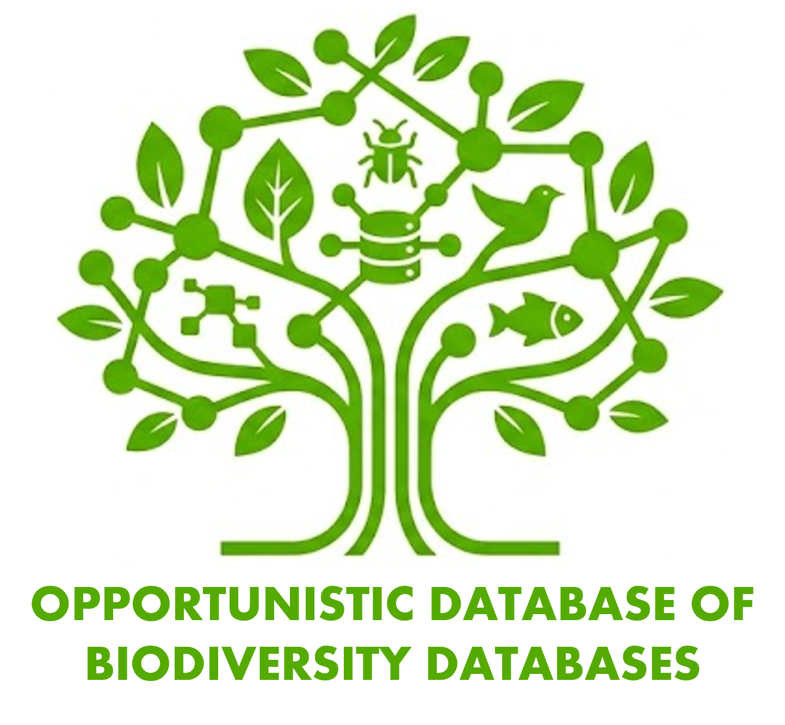
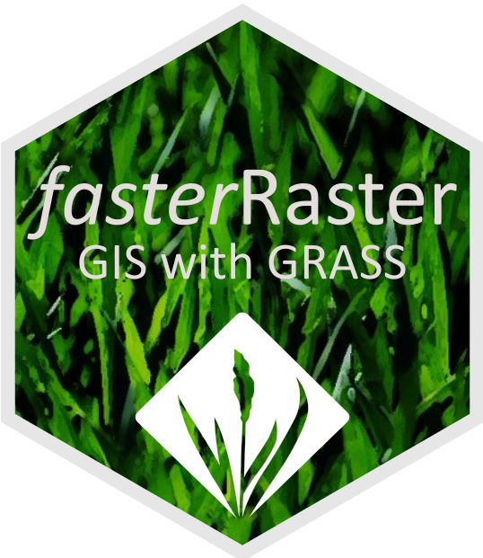
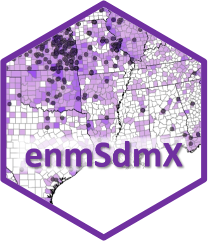

## Databases

We maintain and regularly update the following databases. Neither is an attempt at a systematic survey of databases–thus the “opportunistic” aspect.

::: {.software-entry}
::: {.software-entry-image}
{.img-fluid .w-100 .rounded}
:::

::: {.software-entry-description}
[**The Opportunistic Database of Biodiversity Databases**](https://docs.google.com/spreadsheets/d/1qsK1MNLsi-QjK9VptgeV2HfrB7mWUVxjZdaj_P9Qs-Y/edit?usp=sharing)

An attempt to catalogue the diversity of biodiversity databases, currently with ~400 entries. Looking for specimen databases? Animal tracking data? Traits? Biotic interactions? Range maps? Phylogenies? Images and video? It’s all here!
:::
:::

::: {.software-entry}
::: {.software-entry-image}
{.img-fluid .w-100 .rounded}
:::

::: {.software-entry-description}
[**The Opportunistic Database of Weather Generators**](https://docs.google.com/spreadsheets/d/1JouvQf2VtbdOvzoNuD5xI7kPoTHFC1bIjZiwMkUGc-s/edit?usp=sharing)

A running list of stochastic weather generators. New but growing!
:::
:::

## SDMing

Four-or-so tools I recommend for how to learn to do species distribution modeling:

1. Best Practices in Species Distribution Modeling Workshop: The product of 7 in-person workshops held at international meetings and universities.

    [Download](https://drive.google.com/open?id=1-9PRGFTWZP2wfusJHf3iahyiZeWoExTM&usp=drive_fs) the files, unzip them, open the file therein entitled “00_getting_started.docx”, and get started!

2. [Wallace 2](https://wallaceecomod.github.io/): This is a point-and-click, user-friendly software package that runs through R that streamlines the modeling process, teaches you how to model and provides references where needed, and even writes the R code in the background so you can study and modify it.

3. The [Habitat Suitability and Distribution Models: With Applications in R](https://doi.org/10.1017/9781139028271) book by Guisan, Thuiller, and Zimmerman and [Species Habitat Associations](https://bookdown.org/jfieberg/SHABook/) book (free online) by Matthiopoulos, Fieberg, and Aarts. The former is more of a how-to with a focus on SDM theory, the latter better with the statistical part of theory.

4. [ENM2020](https://www.youtube.com/playlist?list=PLCq9UxocboXPdulJteLT7MYj1WrW_tKcd): A series of free videos on SDMing from some of the world’s experts (a short description is [here](https://doi.org/10.17161/bi.v17i.15016)).

## Software

::: {.software-entry}
::: {.software-entry-image}
{.img-fluid .w-100 .rounded}
:::

::: {.software-entry-description}
Package [*fasterRaster*](https://adamlilith.github.io/fasterRaster/), available on [CRAN](https://cran.r-project.org/package=fasterRaster) for R, is a GIS powerhouse for large-in-memory/large-on-disk rasters. Using [GRASS GIS](https://grass.osgeo.org/) as a backend, fasterRaster emulates nearly all of the functions available in terra with the same name and usually the same arguments. For moderately-sized rasters or smaller, terra will nearly always be faster. But when it’s not, there’s always fasterRaster! Functions exist for:

* Focal, zonal, multi-layer, distance, cropping, resampling, projecting, buffering, applying PCA, de-noising, merging, sampling, hydrology and topography, and much more!
* Creating the 19 BIOCLIM rasters, plus an extended set of BIOCLIMs
* Calculation of landscape fragmentation indices
* Identification of landscape [geomorphons](https://grass.osgeo.org/grass-stable/manuals/r.geomorphon.html)
* And much more!
:::
:::

::: {.software-entry}
::: {.software-entry-image}
{.img-fluid .w-100 .rounded}
:::

::: {.software-entry-description}
Package [*enmSdmX*](https://github.com/adamlilith/enmSdmX), available on [CRAN](https://cran.r-project.org/package=enmSdmX) for R, is a fully-featured package for species distribution modeling and ecological niche modeling, with functions for:

* Bias correction
* Model tuning
* Biotic velocity
* Raster interpolation
* And more!
:::
:::

::: {.software-entry}
::: {.software-entry-image}
{.img-fluid .w-100 .rounded}
:::

::: {.software-entry-description}
Package [*statisfactory*](https://github.com/adamlilith/statisfactory), available on [CRAN](https://cran.r-project.org/package=statisfactory) for R, contains a handful of useful statistical procedures, with functions for:

* Aligned rank transform (useful for using rank data in ANOVAs)
* 2-dimensional histograms
* Histograms with overlapping bins
* Making all possible formulae from a set of predictors
* And more!
:::
:::

::: {.software-entry}
::: {.software-entry-image}
{.img-fluid .w-100 .rounded}
:::

::: {.software-entry-description}
Package [*omnibus*](https://adamlilith.github.io/omnibus/index.html), available on [CRAN](https://cran.r-project.org/package=omnibus) for R, contains handfuls of handy helper functions!

* Display the corners of a large data frame or matrix (top left, top right, etc.; `corner()`)
* Conversion factors for unit conversions (e.g., feet to meters; `convertUnits()`)
* Find values not in a vector (`%notin%`)
* Recursive unlisting of lists (`unlistRecursive()`)
* Handling equalities with `NA`s (`%<=na%`, `%>=na%`, etc.)
* Easily add leading zeros or other characters to a string (`prefix()`)
* And more!
:::
:::

## Unsolicited Advice

[How to Write a Scientific Paper](./blog/how_to_write_a_scientific_paper.html)
